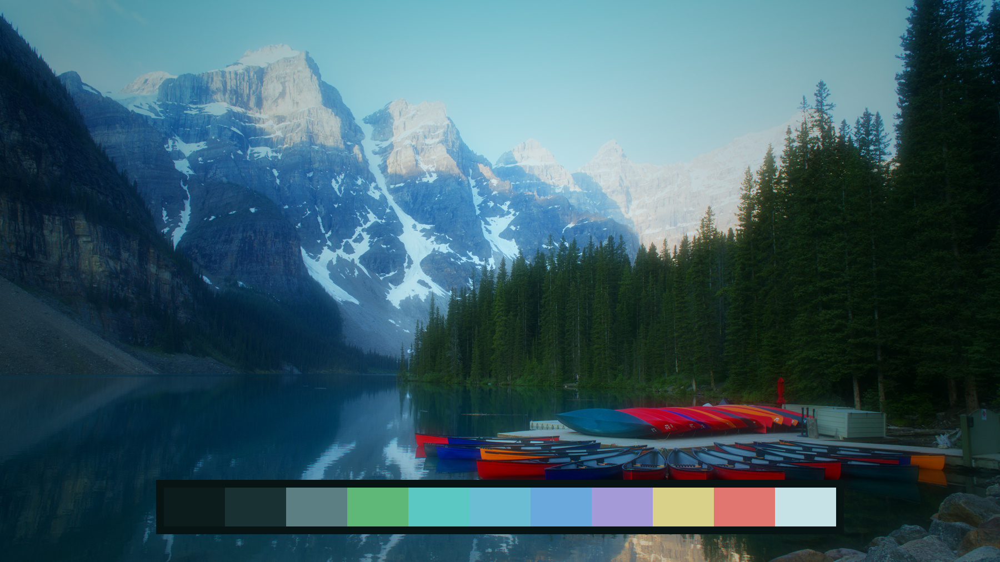
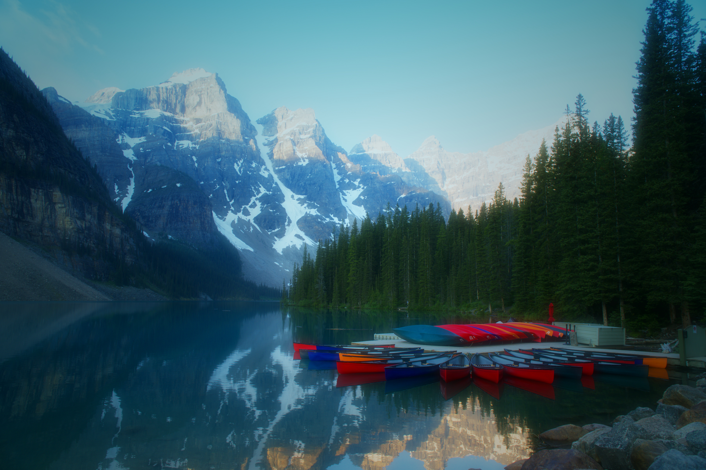
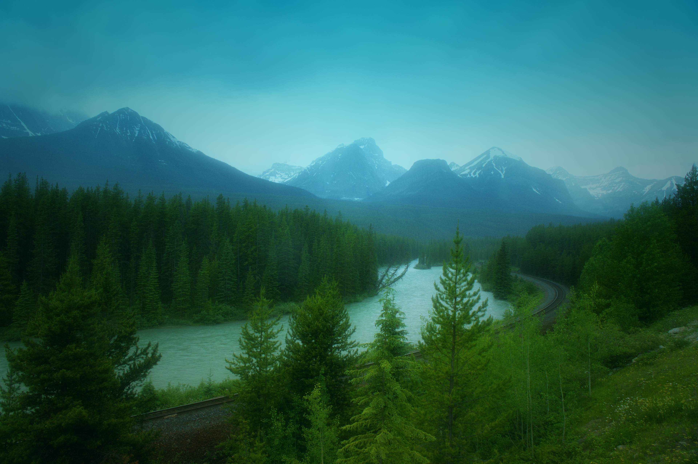
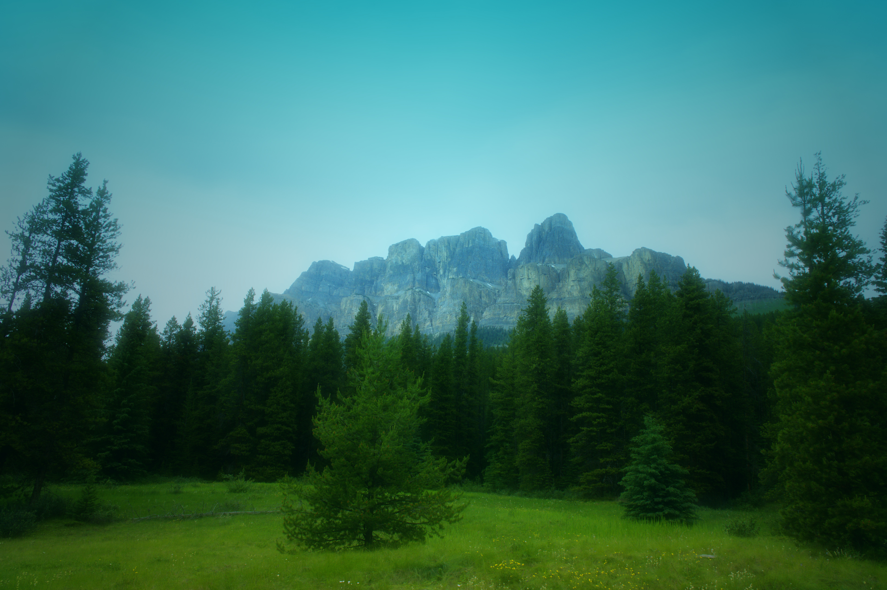
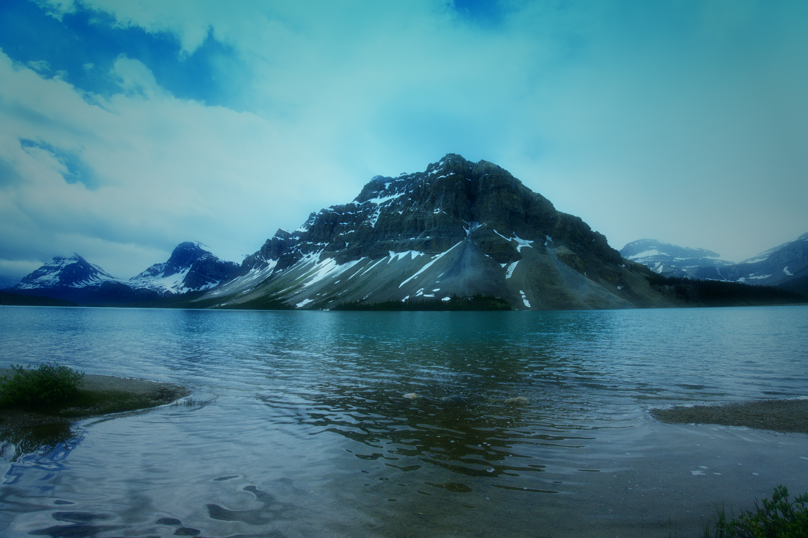

# Alberta

A dark, soothing [Omarchy](https://omarchy.org) theme in cool forest greens and glacial blues, built around four photographs from the Canadian Rockies.



## Install

```bash
omarchy theme install https://github.com/dmcarrington/omarchy-alberta-theme
```

Reapply it later with:

```bash
omarchy theme set alberta
```

## Included

- `colors.toml` — the full palette: deep spruce-teal background, glacial-mist text, a glacial blue accent, and an active window border that fades from glacial blue into forest green.
- `icons.theme` — `Yaru-prussiangreen` icons.
- `backgrounds/` — four 3840×2560 wallpapers. Cycle them with `omarchy theme bg next`.
- `preview.png` — the theme picker preview.
- `dream.sh` — the ImageMagick script used to grade the wallpapers. Omarchy does not run it.

Omarchy generates the Hyprland, terminal, editor, and shell files from `colors.toml`. The repository ships no Lua, terminal configs, or `vscode.json`, so a Git-installed copy looks the same as the original.

## Palette

| Role | Colour |
| --- | --- |
| Background | `#0c1b1c` |
| Foreground | `#c6e2e6` |
| Accent | `#6bbdd4` |
| Green | `#5fb878` |
| Cyan | `#5cc8c4` |
| Blue | `#6aa9dc` |
| Magenta | `#a59ad8` |
| Yellow | `#d9d08a` |
| Red | `#e0766f` |

## Wallpapers

Photographed by David Carrington in Alberta, then graded with a teal-to-glacial-blue wash, a saturation boost, and a soft glow.

| | |
| --- | --- |
|  |  |
|  |  |
